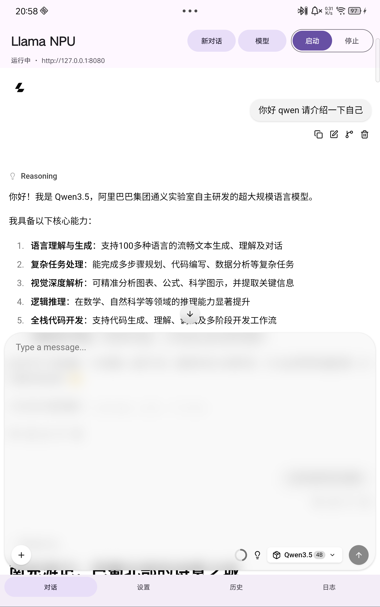
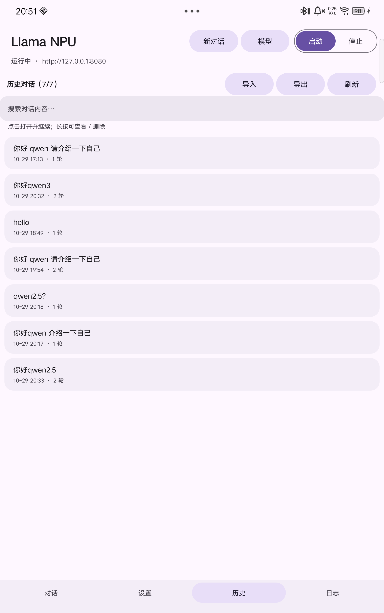

# Hexagon Chat

A minimal Android client that runs **GGUF LLMs locally on Qualcomm Snapdragon** — CPU, Adreno GPU (OpenCL) and **Hexagon NPU (HTP)** — built on top of the official [llama.cpp](https://github.com/ggml-org/llama.cpp) Android prebuilt binaries.

The app wraps `llama-server` in a small native shell, adds a Material 3 dashboard / settings UI, and reuses the llama.cpp Web UI for chatting and history.

| Chat | History |
|---|---|
|  |  |

## Features

- **Three backends**: CPU, Adreno OpenCL, Hexagon HTP (v73/v75/v79/v81/v85 skels bundled).
- **Material 3 UI** with light/dark support: top app bar, segmented start/stop control, cards, bottom navigation.
- **Live dashboard**: SoC / NPU / GPU identification, RAM + swap, thermal state, battery temperature, token/s, tensor placement (`HTP 1879 MiB · OpenCL 617 MiB · CPU 497 MiB`).
- **Tunable at runtime** (only flags supported by the bundled binary are shown):
  backend, context size, `-ngl`, Flash Attention, KV cache types, threads, batch/ubatch, parallel slots,
  load mode (`auto/mmap/mlock/mmap+mlock/none/dio`), KV offload, repack, warmup, sampling, reasoning, metrics, log level.
- **Model manager**: import / switch GGUF files from a second-level menu.
- **Conversation history** read from the llama.cpp Web UI IndexedDB: tap to open and continue, long-press to view / export / delete.
- **JSON import / export** (ChatGPT-style `[{title, messages:[{role, content}]}]`).
- **Reasoning**: keep the thought block expanded after the answer starts; optionally hide per-message stats.

## Requirements

- Snapdragon device with **Hexagon v73+** (8 Gen 2 / 8 Gen 3 / 8 Elite or newer). The NPU backend needs FastRPC and unsigned PD; some OEM firmware may block it — the app then falls back to GPU/CPU.
- Android 9+ (`minSdk 29`), `arm64-v8a`.
- A GGUF model, e.g. a 4B `Q4_0` file. **No model is bundled.**

## Install (prebuilt release)

1. Download `HexagonChat-1.0-debug.apk` from [Releases](../../releases).
2. `adb install -r HexagonChat-1.0-debug.apk`
3. Push a model:
   ```bash
   adb push Qwen3-4B-Q4_0.gguf /sdcard/Android/data/com.dsh.llamahub/files/models/
   ```
4. Open the app → **启动** (Start) → **对话** (Chat).

> The published APK is a **debug build**: signed with the bundled debug keystore and `android:debuggable="true"`.
> It is intended for testing, not for Play Store distribution. See [Signing](#signing).

## Build from source

Prerequisites: JDK 17, Android SDK (build-tools + platform 35), Python 3, `gh` (for downloading the llama.cpp release), `adb`.

```powershell
git clone https://github.com/Xinjigalaxy/hexagon-chat.git
cd hexagon-chat
.\prepare-deps.ps1          # downloads llama.cpp b11980 Snapdragon build, pulls libOpenCL.so from a device
.\build_apk.ps1             # -> out/HexagonChat.apk
```

`prepare-deps.ps1` needs a connected Snapdragon device only for `/vendor/lib64/libOpenCL.so`; that Qualcomm blob is **not** committed to this repository.

Build pipeline: `aapt2 compile/link` → `javac` → `d8` → append `classes.dex` + native libs → `zipalign` → `apksigner`.

## Signing

The release APK is signed with `keystore/debug.keystore`:

- alias `androiddebugkey`, store/key password `android`, RSA 2048, `CN=Android Debug`
- schemes: **v2 + v3** (no v1, `minSdk 29`)
- certificate SHA-256: `0f7a4fabfba2a0eab203c182c8ef056a48c1be08b21ce861e51dfe418ac42ee9`

The debug keystore is committed on purpose so the published APK can be reproduced and updated. It must **never** be used for a production app. For a release build: generate your own keystore, remove `android:debuggable`, bump `versionCode`, and sign with your key.

## How it works

- `app/` — Java sources (`MainActivity`, `M3`, `HistoryStore`) + manifest + icons.
- `assemble.py` — repacks the aapt2 output, `classes.dex`, llama.cpp libs, and the `llama-server` executable (`lib/arm64-v8a/libllamaserver.so`).
- The app execs `llama-server` from `nativeLibraryDir` with `LD_LIBRARY_PATH=<lib>:/vendor/lib64` and `ADSP_LIBRARY_PATH=<lib>`, then drives it over `http://127.0.0.1:8080`.
- Web UI is served by `llama-server` itself; the app injects small scripts for history read/delete/import and UI fixes.

## Privacy

- No telemetry, no network calls except `127.0.0.1`.
- Chats live in the Web UI's local IndexedDB; export files are written only where you choose via the system file picker.

## Limitations

- Qualcomm-specific: HTP backend and OpenCL blob are Snapdragon-only.
- Quantized KV cache (`q4_0/q8_0`) is **not supported on HTP** (missing `SET_ROWS`); the app blocks it and offers f16 or GPU instead. It works on OpenCL/CPU.
- `mlock` does not work for normal apps (Android `RLIMIT_MEMLOCK`); use `none` if you want the model fully resident.
- History import/export uses a simplified JSON schema, not ChatGPT's full `mapping` tree.
- The app is a debug build; expect rough edges.

## Third-party

- [llama.cpp](https://github.com/ggml-org/llama.cpp) — MIT. Prebuilt Android Snapdragon binaries are downloaded at build time.
- Qualcomm `libOpenCL.so` — pulled from the device, not redistributed.
- Models are not included; check each model's license.

## License

MIT — see [LICENSE](LICENSE).
